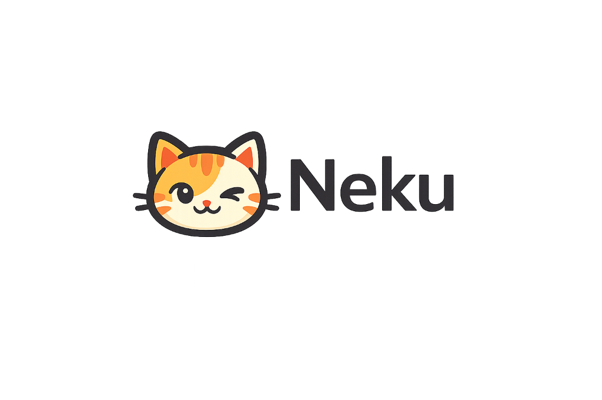

<p align="center">
  
</p>

<p align="center">
  <strong>A native, local-first Windows desktop companion for focus, daily routines, and everyday productivity.</strong><br>
  Neku lives unobtrusively on your desktop, reacting to your focus sprints, daily routines, keyboard typing, and build events.<br>
  Built natively in C# 13 and WPF on .NET 10 with genuine desktop physics, deep customizability, and zero system bloat.
</p>

<p align="center">
  <a href="https://github.com/kunal-gswm/Neku/actions/workflows/ci.yml"></a>
  <a href="https://github.com/kunal-gswm/Neku/releases/tag/v1.0.4"></a>
  <a href="#download-installation"></a>
  <a href="#technology-architecture"></a>
  <a href="#privacy-security-local-first"></a>
  <a href="LICENSE"></a>
</p>

<p align="center">
  <a href="#download-installation"><strong>Download (v1.0.4)</strong></a>
  ·
  <a href="#global-shortcuts-quick-reference">Shortcuts</a>
  ·
  <a href="#overview">Overview</a>
  ·
  <a href="#feature-tour">Features</a>
  ·
  <a href="#2-daily-routines-recurring-tasks">Routines</a>
  ·
  <a href="#terminal-command-interface-cli">CLI</a>
  ·
  <a href="#companion-studio-20--character-system">Companions</a>
  ·
  <a href="#performance-power-resource-benchmarks">Performance</a>
  ·
  <a href="docs/ARCHITECTURE.md">Architecture</a>
  ·
  <a href="CONTRIBUTING.md">Contributing</a>
  ·
  <a href="SECURITY.md">Security</a>
</p>

---

## Overview

Modern desktop environments are crowded with heavy web-wrapped tools that consume gigabytes of memory and silently siphon CPU cycles in the background. **Neku is built on the opposite philosophy:** a responsive, native Windows companion that adds personality and focus to your workstation while maintaining a whisper-light footprint.

```
+-----------------------------------------------------------------------------------+
|                                  NEKU PILLARS                                     |
+-------------------------+-------------------------+-------------------------------+
|   Native & Lightweight  |  Expressive Art & Motion|    Focus & Productivity       |
|  - 0.0% CPU when idle   |  - Desktop Physics 2.0  |  - Daily Routines & Steps     |
|  - ~30-45 MB RAM        |  - Companion Studio     |  - Pomodoro focus timer       |
|  - No Electron bloat    |  - Personality drives   |  - Recurring task schedules   |
|  - Pure .NET 10 & WPF   |  - Window edge landing  |  - Instant notes scratchpad   |
+-------------------------+-------------------------+-------------------------------+
|                     100% Local-First: Zero Telemetry · Zero Cloud                 |
+-----------------------------------------------------------------------------------+
```

### Who is Neku for?
- **Developers & Engineers:** Stay in the zone with Pomodoro synchronization, DeskSense IDE awareness, Git repository status monitoring via Developer Radar, and build/test celebrations triggered from PowerShell or cURL.
- **Writers, Students & Knowledge Workers:** Organize morning/evening workflows with Daily Routines, track recurring tasks, capture thoughts instantly, and keep an endearing desk buddy by your side.
- **Power Users & Gamers:** Enjoy desktop companionship without frame drops or fan spin. Neku automatically detects full-screen games, presentations, and screen-sharing sessions, stepping aside gracefully.

---

## Download & Installation

The latest stable release is **[Neku v1.0.4](https://github.com/kunal-gswm/Neku/releases/tag/v1.0.4)**. Binaries are self-contained: the .NET 10 runtime is bundled internally, so no extra dependencies or frameworks are required.

| Package | File | Description | Recommended For |
|:---|:---|:---|:---|
| **Windows Setup Installer** | [`Neku-Setup-1.0.4.exe`](https://github.com/kunal-gswm/Neku/releases/download/v1.0.4/Neku-Setup-1.0.4.exe) | Per-user setup installer. Configures Start Menu shortcut, optional auto-start with Windows, User `PATH` for the CLI, and a clean uninstaller. No administrator rights required. | **Most Users (Recommended)** |
| **Standalone Portable** | [`Neku.exe`](https://github.com/kunal-gswm/Neku/releases/download/v1.0.4/Neku.exe) | Single self-contained executable. Run directly from any folder or USB drive. Leaves zero registry footprint. | **Portable / USB Drive** |
| **Verification Checksums** | [`SHA256.txt`](https://github.com/kunal-gswm/Neku/releases/download/v1.0.4/SHA256.txt) | SHA256 cryptographic checksums for release asset integrity verification. | **Verification** |

### Option A: Windows Setup Installer (Recommended)
1. Download **`Neku-Setup-1.0.4.exe`** from [GitHub Releases](https://github.com/kunal-gswm/Neku/releases/tag/v1.0.4).
2. Run the installer. It installs per-user into `%LocalAppData%\Programs\Neku` without requiring UAC administrator privileges.
3. (Optional) Check **Start Neku automatically with Windows** or create a Desktop shortcut.
4. Launch Neku from the Start Menu or press <kbd>Ctrl</kbd> + <kbd>Alt</kbd> + <kbd>N</kbd>.

### Option B: Standalone Portable Executable
1. Download **`Neku.exe`** from [GitHub Releases](https://github.com/kunal-gswm/Neku/releases/tag/v1.0.4).
2. Place `Neku.exe` in any folder of your choice (e.g., `C:\Tools\Neku\`).
3. Double-click `Neku.exe` to run. All companion assets and runtimes are embedded.
4. *Note on Windows SmartScreen:* On the very first run of an unsigned executable, Windows SmartScreen may display an informational prompt. Click **More info → Run anyway** to proceed.

### How to Uninstall
- **If installed via Setup:** Open Windows **Settings → Apps → Installed apps**, locate **Neku**, and click **Uninstall**. The uninstaller cleanly removes program files and Start Menu shortcuts while preserving your user notes and settings.
- **If using Portable:** Simply delete `Neku.exe`.
- **To completely purge user data:** Delete `%AppData%\Neku\`.

### System Requirements
- **Operating System:** Windows 10 (version 1809 or higher) or Windows 11 (64-bit).
- **Architecture:** x64.
- **Runtime:** Fully self-contained (.NET 10 Desktop Runtime included; no manual .NET or Git installation needed).

---

## Global Shortcuts Quick Reference

Neku is designed for friction-free keyboard navigation. These global hotkeys work from any active application:

| Shortcut | Action | Description |
|:---|:---|:---|
| <kbd>Ctrl</kbd> + <kbd>Alt</kbd> + <kbd>N</kbd> | **Summon / Unhide** | Launches Neku if stopped, or restores and unhides the running companion without stealing focus from your active window. |
| <kbd>Ctrl</kbd> + <kbd>Alt</kbd> + <kbd>P</kbd> | **Command Palette** | Opens the global quick launcher to start timers, trigger routines, switch companions, or search commands. |
| <kbd>Ctrl</kbd> + <kbd>Alt</kbd> + <kbd>C</kbd> | **Quick Capture** | Opens the lightweight instant task & note capture dialog. |
| <kbd>Ctrl</kbd> + <kbd>Alt</kbd> + <kbd>Q</kbd> | **Graceful Exit** | Safely flushes all unsaved settings and task states to disk, releases named pipes, and closes Neku. |

### In-App Shortcuts
- **<kbd>Ctrl</kbd> + <kbd>1</kbd> to <kbd>8</kbd>:** Switch tabs in Dashboard Window (Overview, Tasks, Focus, History, Insights, Goals, Agent, Radar).
- **<kbd>Ctrl</kbd> + <kbd>N</kbd>:** Create a new task or note.
- **<kbd>Ctrl</kbd> + <kbd>F</kbd>:** Focus the search input in Tasks or Notes.
- **<kbd>F5</kbd> / <kbd>Ctrl</kbd> + <kbd>R</kbd>:** Refresh active view.
- **<kbd>Escape</kbd>:** Close active modal or dismiss transient HUD without losing data.

---

## Feature Tour

### 1. Desktop Companion & Physics 2.0
- **True Desktop Physics:** Velocity integration, gravitational acceleration, window edge boundaries, and smooth platform landing atop your taskbar or application windows.
- **Interactive States:** Drag, toss, boop, and pet your companion. Neku roams your screen, sits, sleeps, yawns, and playfully bats at your mouse cursor.
- **Typing Heat Sync:** Detects active keyboard typing and mirrors your sprint with rapid typing animations and subtle heat glow effects.
- **Multi-Monitor & DPI Aware:** Fully compatible with multi-display configurations, respecting Per-Monitor V2 DPI scaling and distinct work areas.

### 2. Daily Routines & Recurring Tasks
*(Introduced in v1.0.4)*
- **Native Daily Routines UI:** Structure your daily flow (e.g., Morning Startup, Code Review, Evening Shutdown). Track step-by-step progress, mark steps complete, skip optional steps, and resume active sessions.
- **Flexible Recurrence Engine:** Schedule recurring tasks with daily, weekday-only, weekly (multi-day selection), or monthly intervals with accurate calendar handling (month-end dates, leap years).
- **Persistent Reminders:** Local reminders with snoozing support, non-intrusive toast notifications, and reliable firing even after machine reboots.

### 3. Pomodoro Focus Timer
- **Configurable Intervals:** Default 25-minute focus sprints and 5-minute recovery breaks, fully customizable in **Settings → Focus**.
- **Companion Synchronization:** Your pet stays attentive and types alongside you during focus sprints, then rests or stretches during break intervals.
- **Focus History & Analytics:** Review daily and weekly focus trends, session completion counts, and historical focus streaks in Productivity Hub.

### 4. Quick Notes Scratchpad
- **Instant Search:** Real-time substring search across all note titles and bodies as you type.
- **Automatic Saving:** Notes persist automatically to local storage with thread-safe atomic disk writes.

### 5. DeskSense & Developer Radar
- **DeskSense Desktop Awareness:** Detects active IDEs (VS Code, Visual Studio, IntelliJ, Rider), terminals (PowerShell, Windows Terminal), idle/away states, and presentation or screen-sharing modes with contextual pet reactions.
- **Developer Radar Dashboard:** Unified cockpit displaying monitored Git repositories with real-time branch, dirty/uncommitted indicators, build outcome history, and active coding agent count.
- **Floating Developer HUD:** Optional lightweight, draggable, topmost status pill providing at-a-glance visibility into current app context, active Git branch, build state, and Pomodoro timer.

### 6. Local Developer Webhook
- **Build & Test Notifications:** Trigger instant companion celebrations or commiserations directly from PowerShell (`tools/neku-event.ps1`), bash, or cURL after builds, tests, or deployments.
- **Opt-in & Secure:** The loopback HTTP endpoint (`http://localhost:48123/event`) is disabled by default for zero overhead, binds strictly to IPv4 `127.0.0.1`, and rejects external requests.

---

## Terminal Command Interface (CLI)

Neku includes a standalone, lightning-fast terminal CLI (`neku`) for controlling your companion, Pomodoro sprints, routines, tasks, notes, and developer events from PowerShell, Windows Terminal, build scripts, and CI workflows.

> **Full Documentation:** See [docs/CLI.md](docs/CLI.md) for the complete command reference, options, JSON schemas, and scripting examples.

```powershell
# Check status and system health
neku status
neku doctor

# Control companion visibility and animations
neku pet hide
neku pet show
neku pet pause
neku pet resume

# Pomodoro focus sprints
neku focus start --minutes 25
neku focus status
neku focus stop

# Routines and tasks
neku task add "Review pull requests" --priority High
neku task list
neku task complete <id>

# Scratchpad notes
neku note add --title "Ideas" --body "CLI build script integration"
neku note list
neku note search "build"

# Switch companion character
neku companion list
neku companion set billu

# Trigger build and test celebrations
neku event build success --message "Release build compiled cleanly!"
neku event build failure --message "Unit test failure"

# Machine-readable JSON output for PowerShell scripting
neku status --json
```

- **Zero-Friction Windows Integration:** Installed to `%LocalAppData%\Programs\Neku\bin\neku.exe` and automatically registered in your User `PATH`.
- **Local Named-Pipe IPC:** Communicates directly with the running companion via `\\.\pipe\Neku.CommandPipe.{user}`. Zero open internet ports, zero telemetry.
- **Single Source of Truth:** Tasks, notes, routines, and focus timers stay synchronized between terminal and desktop UI.
- **Predictable Exit Codes:** `0` = success, `1` = runtime/offline error, `2` = usage error.

---

## Companion Studio 2.0 & Character System

Neku features an extensible companion architecture supporting distinct visual spritesheets, custom animations, and behavioral drives. Open **Companion Studio** anytime to preview animations, switch companions, import custom characters, and adjust personality presets.

### Built-in Mascot Roster

| Companion | Archetype | Default Personality | Description |
|:---|:---|:---|:---|
| **Neku** | Official Mascot | `Playful` | The spirited, round teal desktop companion who celebrates focus sessions, types alongside you, wanders window frames, and cheers passing builds. |
| **Billu** | Reel Goblin | `Chaotic` | Sarcastic and chaotic orange tabby fueled by doomscrolling Reels humor. Features dramatic side-eyes, exaggerated blinks, facepaws, and flopping. |

*Note: Legacy cat color variants remain preserved in the application engine for backward compatibility and fallback, and can be viewed under the "Legacy Characters" filter.*

### Companion Studio 2.0 Features
Right-click Neku and select **Companion Studio...** (or launch from the Command Palette):
- **📦 One-Click Import:** Import any companion pack directly from a `.zip` archive or extracted folder.
- **🔍 Search & Filter:** Filter companions instantly by name, ID, or category (*Mascots & Originals*, *Imported Custom Packs*, *Personal*, *Legacy*).
- **Live Animated Preview:** Inspect idle, walk, sleep, celebrate, and special animations with interactive playback controls (0.5x, 1x, 1.5x, 2x).
- **Personality Drives:** Switch between **Calm**, **Playful**, **Expressive**, and **Chaotic** drives to adjust roaming frequency, curiosity, and dialogue variety.
- **Pack Management:** Live companion activation, pack removal with safe confirmation, and instant shortcut to open the companion's asset folder in Windows Explorer.
- **Keyboard Shortcuts:** `Ctrl+I` to import ZIP, `Ctrl+Shift+I` to import folder, `Ctrl+F` to search, `F5` to refresh.

### Custom Characters & Modding
Neku supports user-authored companion packs without modifying code or rebuilding. Users can import cartoon, anime, or original characters locally for personal desktop companionship.

To create or package a custom companion, see the comprehensive [Companion Pack & Artist Guide](docs/COMPANION_PACK_GUIDE.md).

```
%AppData%\Neku\Assets\pets\my-custom-companion\
├── manifest.json
└── spritesheet.png
```

```json
{
  "name": "My Custom Companion",
  "author": "PixelArtist",
  "version": "1.0.0",
  "category": "Original",
  "sheet": "spritesheet.png",
  "cellWidth": 64,
  "cellHeight": 64,
  "columns": 4,
  "scale": 1.0,
  "animations": {
    "idle": { "frames": [0, 1, 2, 3], "fps": 4.0, "loop": true },
    "walk": { "frames": [4, 5, 6, 7], "fps": 6.0, "loop": true },
    "sleep": { "frames": [8, 9, 10, 11], "fps": 2.0, "loop": true },
    "fall": { "frames": [12, 13], "fps": 5.0, "loop": true },
    "pet": { "frames": [14, 15], "fps": 4.0, "loop": false },
    "typing": { "frames": [16, 17], "fps": 6.0, "loop": true }
  }
}
```

---

## Performance, Power & Resource Benchmarks

Neku is engineered to run continuously alongside code compilation, intensive rendering, and games without causing thermal throttling or degrading frame rates.

### How 0.0% Idle CPU is Achieved
Standard WPF apps using `CompositionTarget.Rendering` receive callbacks on every monitor refresh (60–144 Hz). Neku optimizes this dynamically:
- When the pet is **idle, asleep, paused, or hidden**, Neku completely detaches from `CompositionTarget.Rendering`. Because no frames are dispatched, CPU consumption drops to **0.0%**.
- When actively walking or interacting, Neku renders at an intentional retro pixel-art pace (default: 14 FPS), consuming only ~0.1% – 0.5% CPU.
- Desktop window edge scanning is throttled (every 3 seconds when stationary, every 0.25 seconds during active movement).

### Reproducible Verification
You can measure Neku's live CPU and memory working set on your own machine using the included PowerShell benchmark tool:

```powershell
# Measure Neku process memory and CPU usage
.\tools\benchmark_memory.ps1 -IdleSeconds 60
```

Typical measured resource profile:
- **Idle CPU:** 0.0%
- **Active Motion CPU:** 0.1% – 0.5%
- **RAM Working Set:** ~30–45 MB
- **GPU VRAM:** Optional Software Rendering mode saves ~75 MB VRAM on low-power laptops (**Settings → Performance** or `--software-rendering`).

For deeper profiling documentation, see [docs/PERFORMANCE.md](docs/PERFORMANCE.md).

---

## Privacy, Security & Local-First

- **100% Local-First:** All notes, tasks, routines, focus session logs, preferences, and custom companion assets are stored locally in `%AppData%\Neku\`.
- **Zero Telemetry & Zero Analytics:** Neku contains no tracking SDKs, no analytics beacons, and no crash reporting telemetry.
- **Zero Cloud Accounts & Zero AI Models:** Neku requires no accounts, no API keys, and runs no external AI language model inference.
- **Loopback-Only Integrations:** The Developer Event Listener and Named-Pipe IPC bind strictly to local loopback (`127.0.0.1` / local named pipe) and reject non-local traffic.
- **Optional Update Notification:** By default, Neku checks GitHub's public releases endpoint on startup to notify you of updates. This check sends zero personal information and can be disabled anytime in **Settings → Performance** (`enableAutoUpdate: false`).
- **Responsible Disclosure:** For our security policy and confidential vulnerability reporting instructions, see [SECURITY.md](SECURITY.md).

---

## Technology & Architecture

- **Runtime & Language:** C# 13, .NET 10, Windows Presentation Foundation (WPF).
- **Win32 Interop:** Employs `WS_EX_NOACTIVATE` and `WS_EX_LAYERED` window styles to guarantee the pet window never steals keyboard focus from active games, editors, or terminals.
- **Physics Engine:** Vector math, floor and window collision detection, velocity clamping, and state machine transitions.
- **Data Persistence:** Thread-synchronized JSON storage with atomic `.tmp` staging to prevent file corruption during sudden power events.

For architecture diagrams and state machine specifications, see:
- [docs/ARCHITECTURE.md](docs/ARCHITECTURE.md) — Architecture diagrams, state machines, and component hierarchy.
- [docs/CLI.md](docs/CLI.md) — Terminal command reference, named pipe IPC, and JSON schemas.
- [docs/PERFORMANCE.md](docs/PERFORMANCE.md) — Power consumption and memory profiling guide.
- [docs/TESTING.md](docs/TESTING.md) — Test matrix, STA test patterns, and test coverage.

---

## Repository Structure

```
├── .github/
│   ├── ISSUE_TEMPLATE/         # GitHub Issue Forms (Bug Report, Feature Request)
│   ├── workflows/              # GitHub Actions CI and Release pipelines
│   └── pull_request_template.md # Pull request submission template
├── docs/                       # Architecture, testing, and release documentation
│   ├── assets/readme/          # README media, logo, and social preview graphic
│   ├── ARCHITECTURE.md         # Component diagrams and state machines
│   ├── CLI.md                  # Terminal command reference and JSON schemas
│   ├── PERFORMANCE.md          # Power, render loop, and memory profiling
│   └── TESTING.md              # Test matrix and coverage guidelines
├── installer/
│   └── Neku.iss                # Inno Setup 6 installer definition
├── scripts/
│   ├── build-installer.ps1     # Compiles Windows Setup installer to artifacts/
│   ├── package-release.ps1     # Release build and packaging pipeline
│   └── publish.ps1             # Self-contained single-file publish script
├── src/
│   ├── DesktopPet/             # Main WPF application (.NET 10)
│   │   ├── Assets/pets/        # Public companion packs (neku, billu, cat variants)
│   │   ├── Engine/             # Physics, state machine, personality, platform collision
│   │   ├── Native/             # Win32 P/Invoke interop (WS_EX_NOACTIVATE, low-level hooks)
│   │   ├── Services/           # Tasks, routines, reminders, notes, settings, focus timer
│   │   └── UI/                 # Pet window, Command Palette, Companion Studio, Settings
│   ├── Neku.Cli/               # Terminal command-line tool (`neku`)
│   └── Neku.Protocol/          # Shared IPC contracts and named-pipe models
├── tests/
│   └── DesktopPet.Tests/       # Automated xUnit test suites (460+ tests)
├── tools/
│   ├── benchmark_memory.ps1    # Process memory & CPU verification benchmark
│   └── neku-event.ps1          # Helper script for triggering developer webhook events
├── CONTRIBUTING.md             # Contribution guidelines, setup, and code conventions
├── SECURITY.md                 # Security policy and vulnerability reporting
├── LICENSE                     # MIT License
├── THIRD_PARTY_NOTICES.md      # Attribution to PixelPaws and third-party notices
└── README.md                   # Project overview and documentation
```

---

## Building, Testing & Contributing

We welcome contributions! Please review our [Contributing Guide](CONTRIBUTING.md) before submitting pull requests.

### Quick Build & Test Commands

```powershell
# 1. Clone repository
git clone https://github.com/kunal-gswm/Neku.git
cd Neku

# 2. Build in Release mode
dotnet build DesktopPet.sln -c Release --nologo

# 3. Run automated tests
dotnet test DesktopPet.sln -c Release --nologo

# 4. Check formatting
dotnet format DesktopPet.sln --verify-no-changes
```

### Reporting Issues & Requesting Features
- **Bug Reports:** Open an issue using our [Bug Report Form](https://github.com/kunal-gswm/Neku/issues/new?template=bug_report.yml).
- **Feature Ideas:** Suggest an enhancement using our [Feature Request Form](https://github.com/kunal-gswm/Neku/issues/new?template=feature_request.yml).
- **Security Issues:** Privately disclose potential vulnerabilities per our [Security Policy](SECURITY.md).

---

## Attribution & License

- **Neku** is open-source software licensed under the [MIT License](LICENSE).
- Portions of the window management, hooks, and physics foundation are based on [PixelPaws](https://github.com/jordansbc/pixelpaws) by Jordan SBC (MIT License). See [THIRD_PARTY_NOTICES.md](THIRD_PARTY_NOTICES.md) for full notices.
