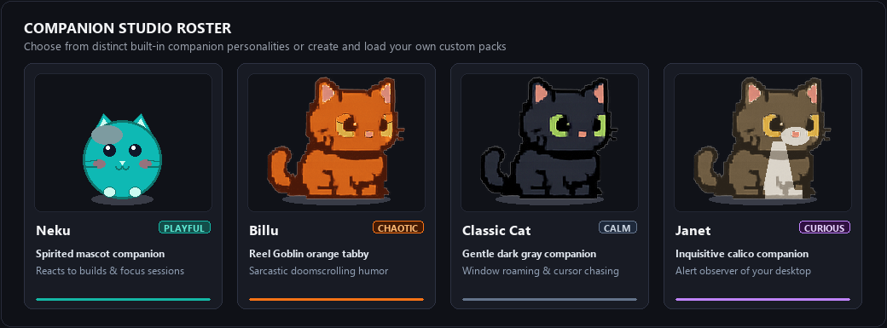

<div align="center">

# Neku

**The lightweight, character-driven desktop companion and productivity pet for Windows.**

Neku lives unobtrusively on your desktop, reacting to your focus sprints, typing, and development events. Built natively in C# and WPF on .NET 10, Neku delivers expressive pixel-art companions with genuine physics, deep customizability, and zero system bloat.

[](https://github.com/kunal-gswm/Neku/actions/workflows/ci.yml)
[](LICENSE)
[](#download--installation)
[](#technology--architecture)
[](#privacy-security--offline-first)

[Overview](#overview) • [Highlights](#feature-highlights) • [Companion Gallery](#companion-gallery--character-system) • [Download](#download--installation) • [Getting Started](#getting-started) • [Productivity](#productivity-tools) • [Custom Companions](#custom-companions--modding) • [Developer Events](#developer-integration) • [Architecture](#technology--architecture) • [Contributing](#building-testing--contributing)

</div>

---

## Overview

Modern developer and desktop environments are filled with resource-heavy web wrappers. Neku is built on the opposite philosophy: a native, responsive desktop companion that brings character and focus to your workstation while maintaining a whisper-light footprint.

```
+-----------------------------------------------------------------------------------+
|                                  NEKU PILLARS                                     |
+-------------------------+-------------------------+-------------------------------+
|   Native & Lightweight  |  Character-Driven Art   |    Focus & Productivity       |
|  - 0.0% CPU when idle   |  - Companion Studio     |  - Pomodoro focus timer       |
|  - ~30-45 MB RAM        |  - Personality presets  |  - Searchable scratchpad      |
|  - No Electron bloat    |  - Real desktop physics |  - Local developer webhook    |
+-------------------------+-------------------------+-------------------------------+
```

- **Native & Power-Efficient:** Built natively with .NET 10 and WPF. Neku completely detaches its render loop from `CompositionTarget.Rendering` when idle or asleep, guaranteeing **0.0% CPU** consumption and low memory usage (~30–45 MB).
- **Expressive Companion Roster:** Choose from distinct companions in Companion Studio—including Neku (the spirited generic mascot), Billu (the sarcastic Reel Goblin orange tabby), and classic cats—each with customizable scale, sound effects, and personality presets.
- **Integrated Productivity Suite:** Stay in the zone with a built-in Pomodoro focus timer that coordinates pet reactions, accompanied by a quick-search scratchpad notes tool accessible via hotkey.
- **Privacy-First & Offline:** 100% offline with zero telemetry, zero analytics, and zero external network calls. All notes, preferences, and custom companion assets stay strictly on your local machine.

---

## Feature Highlights

### Desktop Companion & Physics
- **True Desktop Physics:** Velocity integration, gravity, window edge boundaries, and smooth taskbar platform landing.
- **Interactive States:** Drag, toss, boop, and pet your companion. Neku roams your screen, sits, sleeps, yawns, and playfully bats at your mouse cursor.
- **Typing Heat Sync:** Detects active keyboard typing and mirrors your sprint with rapid typing animations and subtle heat glow effects.
- **Multi-Monitor Awareness:** Fully compatible with multi-display setups, respecting Per-Monitor V2 DPI scaling and screen bounds.

### Productivity & Workflow
- **Pomodoro Focus Timer:** Configurable sprint and break intervals with audio cues and companion synchronizations (attentive typing during work, relaxing during breaks).
- **Quick Notes Scratchpad:** Lightweight local scratchpad with instant substring filtering, keyboard shortcuts, and automatic saving.
- **Global Keyboard Controls:**
  - `Ctrl + Alt + N` — Summon / Launch Neku without stealing focus or creating duplicate instances.
  - `Ctrl + Alt + Q` — Gracefully exit Neku, flushing all settings to disk and releasing mutexes.

### Developer Event Integration
- **Local Event Listener:** Loopback HTTP endpoint (`http://localhost:48123/event`) disabled by default for zero overhead.
- **Build & Test Notifications:** Trigger instant pet celebrations or commiserations directly from PowerShell (`tools/neku-event.ps1`), bash, or cURL after builds, tests, or deployments.

---

## Companion Gallery & Character System

Neku features a modular character architecture supporting distinct visual spritesheets and behavioral definitions. Open **Companion Studio** anytime to preview animations, switch companions, and adjust personality presets.



### Built-in Public Companions

| Companion | Archetype | Personality Preset | Description |
|:---|:---|:---|:---|
| **Neku** | Mascot Companion | `Playful` | The spirited, round teal companion who loves celebrating your focus sessions, typing alongside you, and cheering passing builds. |
| **Billu** | Reel Goblin | `Chaotic` | Sarcastic, smug, and chaotic orange tabby fueled by 8 hours of doomscrolling Reels. Features original internet quips, dramatic side-eyes, exaggerated blinks, facepaws, and flopping. |
| **Classic Cat** | Standard Tabby | `Calm` | The beloved calm gray tabby that wanders your taskbar, naps peacefully, and chases your cursor. |
| **Janet** | Calico Variant | `Curious` | Alert, inquisitive tortoiseshell/calico companion that keenly observes your desktop activity. |
| **Color Variants** | Tabby Variants | `Custom` | Additional built-in tabby coats including Orange, Silver, Cream, Chocolate, and Slate Blue. |

### Companion Studio

Right-click Neku and select **Companion Studio...** to access the customization hub:
- **Live Animated Preview:** Inspect idle, walk, sleep, celebrate, and special animations with interactive playback controls.
- **Personality Presets:** Switch between **Calm**, **Playful**, **Expressive**, **Chaotic**, and **Custom** drives to adjust roaming frequency, curiosity, and dialogue variety.
- **Size Scaling:** Dynamically scale your pet from 0.5x to 2.0x desktop size.
- **Animation Speed & Sound:** Fine-tune animation frame pacing and toggle audio cues.

---

## Download & Installation

### Release Status

- **Latest Published Release:** **v0.2.1** is available as a portable binary download on the [GitHub Releases](https://github.com/kunal-gswm/Neku/releases) page.
- **Current Development Version:** Version **0.4.0** (introducing the Inno Setup installer, Companion Studio, Billu, and refined global hotkeys) is in final release preparation on `main`. You can build and run it directly from source today, or download `v0.2.1` from Releases.

### Installation Methods (v0.4.0+)

#### Option A: Windows Setup Installer (Recommended)
1. Download `Neku-Setup-x.x.x.exe` from the [Releases](https://github.com/kunal-gswm/Neku/releases) page once published, or build it locally using `.\scripts\build-installer.ps1`.
2. Run the installer. It will install Neku to `%LocalAppData%\Programs\Neku` without requiring administrator privileges.
3. Choose whether to add a desktop shortcut or start Neku automatically with Windows.
4. Manage or uninstall cleanly at any time through Windows **Installed apps** or **Settings**.

#### Option B: Portable Executable
1. Download `Neku.exe` from [Releases](https://github.com/kunal-gswm/Neku/releases), or build it via `.\scripts\publish.ps1`.
2. Place `Neku.exe` in any folder of your choice (e.g., `C:\Tools\Neku\`).
3. Double-click to run. All assets are self-contained within the executable.

### System Requirements

- **Operating System:** Windows 10 (version 1809 or higher) or Windows 11 (64-bit).
- **Runtime:** .NET 10 Desktop Runtime (included in self-contained binaries and setup installer; no separate installation required).
- **Architecture:** x64.

### Global Shortcuts Quick Reference

| Shortcut | Action | Description |
|:---|:---|:---|
| <kbd>Ctrl</kbd> + <kbd>Alt</kbd> + <kbd>N</kbd> | **Summon / Launch** | Launches Neku if stopped, or restores and unhides the running instance without stealing focus. |
| <kbd>Ctrl</kbd> + <kbd>Alt</kbd> + <kbd>Q</kbd> | **Graceful Exit** | Flushes unsaved state, cleans up global hotkeys, and cleanly exits the application. |

---

## Getting Started

### First Launch
When Neku starts, your companion will appear atop your primary monitor's taskbar.

```
           /\_/\
          ( o.o )  *loafing on your taskbar*
          > ^ <
==================================================== [Taskbar]
```

### Basic Interactions
- **Left-Click:** Wake up, pet, or play with your companion.
- **Left-Click & Drag:** Pick up and position the pet anywhere on your screen or drop them onto top window borders.
- **Right-Click:** Open the context menu to toggle the **Focus Timer**, **Quick Notes**, **Companion Studio**, or **Settings**.
- **System Tray:** Access quick controls, toggle visibility, or exit via the Neku tray icon.
- **Global Hotkeys:** Press <kbd>Ctrl</kbd> + <kbd>Alt</kbd> + <kbd>N</kbd> anytime to summon or restore Neku, or <kbd>Ctrl</kbd> + <kbd>Alt</kbd> + <kbd>Q</kbd> to exit gracefully.

---

## Productivity Tools

### Focus Timer (Pomodoro)
The integrated focus timer helps structure productive work sessions without intrusive popups.

- **Configurable Intervals:** Default 25-minute focus sprints and 5-minute recovery breaks, fully customizable in **Settings > Focus**.
- **Unobtrusive HUD:** Displays remaining sprint time and current phase near your companion.
- **Companion Synchronization:** Your pet remains attentive and types alongside you during focus sprints, then rests or stretches during break intervals.
- **Audio Chimes:** Optional soft chimes signal interval completions.

### Quick Notes Scratchpad
A distraction-free scratchpad designed for rapid thought capture, temporary snippets, and daily checklists.

- **Instant Search:** Real-time substring search filters across all note titles and bodies as you type.
- **Automatic Saving:** Notes persist automatically to `%AppData%\Neku\notes.json`.
- **Keyboard Navigation:**
  - <kbd>Ctrl</kbd> + <kbd>N</kbd> — Create a new note.
  - <kbd>Ctrl</kbd> + <kbd>F</kbd> — Focus search bar.
  - <kbd>Delete</kbd> — Delete selected note.

---

## Custom Companions & Modding

Neku supports loading custom, user-authored companion packs without modifying source code or rebuilding the application.

### Directory Structure
Place your custom companion pack in `%AppData%\Neku\Assets\pets\<pack-name>\` (or in an `Assets\pets\<pack-name>\` folder beside `Neku.exe`):

```
%AppData%\Neku\Assets\pets\my-custom-companion\
├── manifest.json
└── spritesheet.png
```

### Manifest Format (`manifest.json`)
```json
{
  "name": "My Custom Companion",
  "sheet": "spritesheet.png",
  "cellWidth": 128,
  "cellHeight": 128,
  "columns": 4,
  "scale": 1.0,
  "animations": {
    "idle": { "frames": [0, 1], "fps": 2.0, "loop": true },
    "walk": { "frames": [2, 3, 4, 5], "fps": 6.0, "loop": true },
    "sleep": { "frames": [6, 7], "fps": 1.0, "loop": true },
    "fall": { "frames": [8, 9], "fps": 4.0, "loop": true },
    "drag": { "frames": [10], "fps": 1.0, "loop": true },
    "happy": { "frames": [11, 12], "fps": 3.0, "loop": true },
    "annoyed": { "frames": [13, 14], "fps": 3.0, "loop": true },
    "surprised": { "frames": [15], "fps": 1.0, "loop": false }
  }
}
```

Once placed, open **Companion Studio** or **Settings > Appearance** to select and apply your new companion immediately.

---

## Developer Integration

Neku can react to development lifecycle events—such as build completions, test failures, or deployment scripts—via a local HTTP listener on port `48123`.

### Enabling the Endpoint
1. Open **Settings** (Right-click Neku → **Settings**).
2. Navigate to the **Developer** tab.
3. Check **Enable Developer Event Endpoint (Port 48123)** and click **Apply & Close**.

### Triggering Events from PowerShell
Use the included helper script [`tools/neku-event.ps1`](tools/neku-event.ps1):

```powershell
# Notify successful build
.\tools\neku-event.ps1 build_success "Build passed in 2.1s! 🎉"

# Notify test suite failure
.\tools\neku-event.ps1 test_fail "3 tests failed in Core.Tests"

# Notify custom command completion
.\tools\neku-event.ps1 command_complete "Deployment container ready!"
```

### Triggering Events via cURL
```bash
curl -X POST http://127.0.0.1:48123/event \
  -H "Content-Type: application/json" \
  -d '{"type":"build_success","message":"Release compiled cleanly!"}'
```

Supported event types: `build_success`, `build_failure`, `test_pass`, `test_fail`, `command_complete`.

---

## Technology & Architecture

Neku is engineered to run seamlessly alongside demanding workloads, code compilation, and games without stutter or resource contention.

### Core Stack
- **Framework & Runtime:** C# 13, .NET 10, Windows Presentation Foundation (WPF).
- **Win32 Interop:** Uses `WS_EX_NOACTIVATE` and `WS_EX_LAYERED` window styles to ensure the pet window never steals focus from your active IDE, terminal, or game.
- **Physics Simulation:** Vector math, floor and window collision detection, velocity clamping, and state machine transitions.
- **Rendering Architecture:** Detaches completely from `CompositionTarget.Rendering` when idle or asleep, achieving **0.0% CPU** consumption. Full-screen particle overlays instantiate on demand and release DirectX swap chains immediately after playback.
- **Optional Software Rendering:** Toggleable via **Settings > Performance** or the `--software-rendering` CLI flag, saving ~75 MB of GPU VRAM on lightweight laptops.

For deeper technical documentation, see:
- [docs/ARCHITECTURE.md](docs/ARCHITECTURE.md) — Architecture diagrams, state machines, and component hierarchy.
- [docs/PERFORMANCE.md](docs/PERFORMANCE.md) — Memory benchmarks, rendering profiling, and power consumption analysis.

---

## Repository Structure

```
├── .github/workflows/          # GitHub Actions CI and release automation
├── docs/
│   ├── assets/readme/          # README media and companion gallery graphic
│   ├── ARCHITECTURE.md         # Component architecture and state diagrams
│   ├── BASELINE_AUDIT.md       # Technical audit of initial codebase
│   ├── PERFORMANCE.md          # Rendering, memory profiling, and power benchmarks
│   └── TESTING.md              # Test matrix, architecture, and verification
├── installer/
│   └── Neku.iss                # Inno Setup 6 installer definition
├── src/
│   └── DesktopPet/             # Main Neku WPF application (.NET 10)
│       ├── Assets/pets/        # Public companion packs (neku, billu, cat variants)
│       ├── Engine/             # Physics, state machine, personality, platform geometry
│       ├── Native/             # Win32 P/Invoke interop wrappers (WS_EX_NOACTIVATE, hooks)
│       ├── Services/           # Focus timer, notes, settings, tray, developer webhook
│       └── UI/                 # Pet window, Companion Studio, notes, settings
├── tests/
│   └── DesktopPet.Tests/       # Automated xUnit test suites
├── tools/
│   ├── benchmark_memory.ps1    # Automated memory & CPU benchmark script
│   ├── measure_interactive.ps1 # Interactive lifecycle benchmark script
│   ├── neku-event.ps1          # PowerShell developer event trigger CLI
│   └── neku-event.bat          # Batch developer event trigger CLI
├── scripts/
│   ├── build-installer.ps1     # Inno Setup installer compilation script
│   ├── install.ps1             # Development installation script
│   └── publish.ps1             # Self-contained single-file publish script
├── THIRD_PARTY_NOTICES.md      # Attribution to PixelPaws and third-party notices
├── LICENSE                     # MIT License
└── README.md                   # Project overview and documentation
```

---

## Building, Testing & Contributing

### Prerequisites
- [.NET 10 SDK](https://dotnet.microsoft.com/download/dotnet/10.0) (10.0.100 or newer)
- Visual Studio 2026, VS Code with C# Dev Kit, or JetBrains Rider
- [Inno Setup 6](https://jrsoftware.org/isinfo.php) (optional; needed only to build the Windows setup installer)

### Build Commands

```powershell
# 1. Clone the repository
git clone https://github.com/kunal-gswm/Neku.git
cd Neku

# 2. Build the solution in Release mode
dotnet build DesktopPet.sln -c Release --nologo

# 3. Run automated tests
dotnet test DesktopPet.sln -c Release --nologo

# 4. Publish self-contained single-file binary to dist/Neku.exe
.\scripts\publish.ps1

# 5. (Optional) Compile the Windows Setup installer to artifacts/
.\scripts\build-installer.ps1
```

For detailed test coverage and testing conventions, refer to [docs/TESTING.md](docs/TESTING.md).

### Contributing Guidelines
1. Fork the repository and create a feature branch (`git checkout -b feature/my-feature`).
2. Maintain documentation integrity and preserve nullable annotations (`#nullable enable`).
3. Ensure all tests pass (`dotnet test DesktopPet.sln -c Release --nologo`).
4. Submit a descriptive Pull Request detailing changes and visual/runtime verification.

---

## Privacy, Security & Offline First

- **Zero Telemetry:** Neku has zero tracking, zero analytics, and zero crash reporting beacons.
- **100% Offline:** The application never makes outbound network connections.
- **Loopback-Only Webhook:** The developer event listener binds strictly to local loopback (`127.0.0.1`), is disabled by default, and processes only predefined event types.
- **Local State Storage:** All notes, preferences, and custom companion assets are stored exclusively in `%AppData%\Neku\`.
- **Private Asset Isolation:** Personal local companion artwork remains strictly isolated in local AppData and is never bundled into public release distributions.

---

## Attribution & License

- **Neku** is open-source software licensed under the [MIT License](LICENSE).
- Portions of the window management, hooks, and physics foundation are based on [PixelPaws](https://github.com/jordansbc/pixelpaws) by Jordan SBC (MIT License). See [THIRD_PARTY_NOTICES.md](THIRD_PARTY_NOTICES.md) for full notices.
