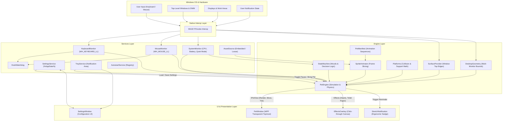
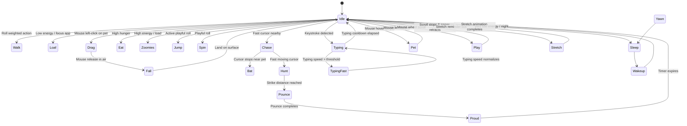

# Architecture Documentation

This document describes the software architecture, core subsystems, runtime lifecycle, and design patterns of the **Neku** desktop companion application (built on the transformed **PixelPaws** foundation).

---

## 1. System Overview & Component Diagram

Neku follows a decoupled, layered architecture designed for low-overhead desktop simulation, strict separation of concerns, and robust native Windows integration.



---

## 2. Main Modules and Responsibilities

### 2.1 Engine Subsystem (`DesktopPet.Engine`)

The engine contains the platform-independent mathematics, simulation rules, and behavioral modeling.

- **[`PetEngine`](../src/DesktopPet/Engine/PetEngine.cs)**:
  - Serves as the central coordinator of the simulation.
  - Subscribes to the per-frame update loop (`CompositionTarget.Rendering`).
  - Evaluates physics (velocity, gravity, terminal speed), user interactions (drag, hover, cursor chase), and state transitions.
  - Interacts with the view via the decoupled [`IPetView`](../src/DesktopPet/Engine/PetEngine.cs#L10-L32) interface.
- **[`StateMachine`](../src/DesktopPet/Engine/StateMachine.cs)**:
  - Encapsulates the pet's behavioral drives: `Energy` ($[0, 1]$) and `Hunger` ($[0, 1]$).
  - Determines transition durations and selects the next action from idle via weighted probability rolls influenced by time of day, system load, and foreground activity.
- **[`SurfaceProvider`](../src/DesktopPet/Engine/SurfaceProvider.cs)**:
  - Queries Win32 to enumerate visible, non-minimized, non-cloaked top-level windows in z-order.
  - Derives horizontal surface segments (the top window border/title bar) where the pet can land and walk.
- **[`Platforms`](../src/DesktopPet/Engine/Platforms.cs)**:
  - Pure static mathematics library for collision detection.
  - Provides `IsSupported()` and `TryLand()` using zero-allocation index iteration across surface spans.
- **[`DesktopGeometry`](../src/DesktopPet/Engine/DesktopGeometry.cs)**:
  - Aggregates all active monitors into a single virtual bounding rectangle.
  - Tracks individual monitor work areas (accounting for taskbars on any side and heterogeneous DPI configurations).
- **[`SpriteAnimator`](../src/DesktopPet/Engine/SpriteAnimator.cs)**:
  - Reads sprite sheets and slices them into cached `CroppedBitmap` frames based on [`PetManifest`](../src/DesktopPet/Engine/PetManifest.cs) JSON descriptions.
  - Manages playback FPS, loop counts, and frame advancement.

### 2.2 Services Subsystem (`DesktopPet.Services`)

Handles infrastructure, host OS monitoring, persistence, and external interaction.

- **[`SettingsService`](../src/DesktopPet/Services/SettingsService.cs)** & **[`AppSettings`](../src/DesktopPet/Services/AppSettings.cs)**:
  - Strongly typed JSON settings deserialization and serialization targeting `%AppData%\Neku\settings.json`.
- **[`TrayService`](../src/DesktopPet/Services/TrayService.cs)**:
  - Manages the Windows system tray (`NotifyIcon`), its context menu, dynamic pause/resume states, and double-click actions.
- **[`KeyboardMonitor`](../src/DesktopPet/Services/KeyboardMonitor.cs)** & **[`MouseMonitor`](../src/DesktopPet/Services/MouseMonitor.cs)**:
  - Low-level Win32 hooks (`SetWindowsHookEx`) running on the UI thread to capture keystrokes (calculating keys-per-second typing heat) and mouse wheel delta (triggering scroll play).
- **[`HookWatchdog`](../src/DesktopPet/Services/HookWatchdog.cs)**:
  - Background health check ensuring hooks remain active; automatically reinstalls hooks if the Windows OS unhooks them due to message loop timeouts.
- **[`SystemMonitor`](../src/DesktopPet/Services/SystemMonitor.cs)**:
  - Samples CPU usage, battery level, active window category (focus app, browser, game), and OS notification state (`SHQueryUserNotificationState`).
- **[`AutostartService`](../src/DesktopPet/Services/AutostartService.cs)**:
  - Writes/removes user autostart entries in `HKCU\Software\Microsoft\Windows\CurrentVersion\Run`.
- **[`AssetSource`](../src/DesktopPet/Services/AssetSource.cs)**:
  - Multi-tier asset discovery loader that checks per-user imported companion packs (%AppData%/Neku/Assets/pets/<name>), local application directories (Assets/pets/<name>), and compiled-in assembly embedded resources for single-file deployment. Categorizes packs into Mascots, Personal, Imported Custom Packs, and Legacy Characters.
- **[CompanionPackService](../src/DesktopPet/Services/CompanionPackService.cs)**:
  - Custom companion pack management engine. Provides zip archive extraction and folder import with transactional staging, manifest schema validation, spritesheet frame bounding checks, archive traversal (../) defense, zip bomb threshold guards (50MB / 500 entries limit), and executable file rejection. Enforces protected pack deletion guards and automatic active-pet fallback.

### 2.3 UI & Presentation Subsystem (`DesktopPet.UI`)

- **[`PetWindow`](../src/DesktopPet/UI/PetWindow.xaml.cs)**:
  - Transparent, borderless, topmost WPF window (`WindowStyle=None`, `AllowsTransparency=True`).
  - Implements `IPetView` to render frames, mirror sprite horizontally according to facing direction, and apply red heat tinting during rapid typing.
- **[`EffectsOverlay`](../src/DesktopPet/UI/EffectsOverlay.cs)**:
  - Persistent, transparent, click-through overlay window spanning the entire virtual desktop.
  - Draws dynamic visual effects (floating hearts on hover, toilet paper ribbons on mouse scroll, dropped pebbles).
- **[`SettingsWindow`](../src/DesktopPet/UI/SettingsWindow.xaml.cs)**:
  - Tabbed WPF configuration dialog for behaviors, display scale, quiet mode, and diagnostic options.

---

## 3. State Machine & Personality Design

The pet's autonomy is governed by a probabilistic, drive-based state machine implemented in [`StateMachine`](../src/DesktopPet/Engine/StateMachine.cs).

### 3.1 Continuous Drives

The pet maintains two internal analog variables ($[0.0, 1.0]$):
1. **Energy**:
   - Drains during high exertion (`Walk`, `Zoomies`, `Chase`, `Hunt`, `Pounce`, `Bat`, `Spin`, `Jump`).
   - Recovers during rest (`Sleep`, `Yawn`, `Loaf`, `SideRest`).
   - Drifts toward a neutral baseline ($0.6$) when idle.
2. **Hunger**:
   - Slowly increases over time ($+1.0$ per 15 minutes).
   - Decreases rapidly when in the `Eat` state.

### 3.2 State Transition Flow



### 3.3 Weighted Selection Algorithm

When the pet is in `Idle` and the state timer reaches zero:
1. Multipliers are calculated:
   - `rest = 1.0 + (1.0 - Energy) * 2.5 + nightBonus + lowBatteryBonus + focusAppBonus`
   - `active = 1.0 + Energy * 2.0 + cpuLoad * 1.5 + playAppBonus - nightPenalty - focusPenalty`
2. Weights are assigned to candidate states:
   - `Walk`: baseline weight 2.0
   - `Loaf`: $1.0 \times rest$
   - `SideRest`: $0.8 \times rest$
   - `Sleep` (via `Yawn`): $0.9 \times rest$
   - `Eat`: $0.8 + Hunger \times 5.0$
   - `Zoomies`: $0.9 \times active$
   - `Jump`: $2.2 \times active$
   - `Spin`: $0.5 \times active$
3. A random roll selects the state, and a randomized duration timer is assigned.

---

## 4. Animation System

The animation pipeline transforms sprite sheets into hardware-accelerated WPF visual elements:

1. **Sprite Sheet Specifications**:
   - Grid-based PNG image (e.g., 4 columns by 11 rows = 44 cells).
   - Each cell represents a square frame (e.g., 128×128 DIP).
   - Frames face right by default.
2. **Metadata Manifest (`manifest.json`)**:
   - Defines grid dimensions (`columns`, `rows`, `cellWidth`, `cellHeight`).
   - Defines named animations with frame index sequences and frame durations (e.g., `"walk": { "frames": [4, 5, 6, 7], "fps": 8 }`).
3. **Slicing and Caching**:
   - [`SpriteAnimator`](../src/DesktopPet/Engine/SpriteAnimator.cs) loads the image and caches `CroppedBitmap` instances for each cell index to eliminate per-frame allocations.
4. **Transformations & Tinting**:
   - Horizontal facing (+1 right, -1 left) is applied via a `ScaleTransform` ($X = -1$) on the WPF `Image` control.
   - Fast typing triggers a custom shader/tint transition in `PetWindow.SetHeatLevel()`.

---

## 5. Physics and Collision

All spatial units in the simulation are expressed in **WPF Device-Independent Pixels (DIPs, 1/96th of an inch)**.

### 5.1 Kinematic Constants

- **Gravity ($g$)**: $2000 \text{ DIP/s}^2$
- **Terminal Fall Velocity ($v_{\text{max}}$)**: $2600 \text{ DIP/s}$
- **Base Walk Speed**: $55 \text{ DIP/s}$
- **Chase Speed**: $115 \text{ DIP/s}$
- **Zoomies Speed**: $360 \text{ DIP/s}$
- **Jump Impulse ($v_y$)**: $-800 \text{ DIP/s}$ (produces an upward arc of $\approx 160\text{ DIP}$ with airtime $\approx 0.8\text{ s}$)
- **Support Tolerance**: $3.0\text{ DIP}$

### 5.2 Surface Detection & Collision Detection

Surfaces represent one-dimensional horizontal line segments:
$$\text{Surface} = \{ \text{Left}, \text{Width}, \text{Top} \}$$

Surfaces are sourced from:
1. **Monitor Work Areas**: Bottom edge of each monitor's work area (above the Windows taskbar).
2. **Top-Level Window Frames**: Win32 `EnumWindows` + `DwmGetWindowAttribute(DWMWA_EXTENDED_FRAME_BOUNDS)` retrieves the top edge of visible windows.

**Support Verification**:
A pet with horizontal center $X_c$ and bottom edge $Y_{\text{feet}}$ is supported if:
$$\exists s \in \text{Surfaces} : (s.\text{Left} \le X_c \le s.\text{Right}) \land (|s.\text{Top} - Y_{\text{feet}}| \le \text{Tolerance})$$

**Landing Calculation during Fall**:
For feet moving from $Y_{\text{prev}}$ to $Y_{\text{next}}$ in time $\Delta t$, the landing surface is the highest surface satisfying:
$$(s.\text{Left} \le X_c \le s.\text{Right}) \land (Y_{\text{prev}} - \text{Tolerance} \le s.\text{Top} \le Y_{\text{next}})$$

---

## 6. Settings Persistence & Continuity

### 6.1 Schema & Location

Settings are saved in `%AppData%\Neku\settings.json` (migrated from `%AppData%\PixelPaws\settings.json`).

The schema covers:
- Core options: `speed`, `sizeScale`, `activePet`, `autostart`.
- Behavioral toggles: `enableWindowWalking`, `enableCursorChase`, `enableSleep`, `enableScrollPlay`, `enableMoods`, `enableSystemReactions`.
- Quiet mode settings: `enableQuietMode`, `hideWhenPresenting`.
- Continuity states: `rememberPetState`, `lastPetX`, `lastPetY`, `lastEnergy`, `lastHunger`.

### 6.2 Persistence Strategy

1. **Lazy Periodic Flush**: A 30-second `DispatcherTimer` writes the pet's current location and mood drives to prevent loss during abrupt logoff.
2. **Clean Shutdown Flush**: On application quit or system shutdown, `CaptureStateInto` writes the exact final coordinates and energy levels to disk.
3. **Safe Deserialization**: Deserialization wraps all read calls in a fallback block; any JSON parse error restores safe defaults without crashing.

---

## 7. Lifecycle Management

```mermaid
sequenceDiagram
    autonumber
    actor User
    participant OS as Windows OS
    participant App as App.xaml.cs
    participant Mutex as SingleInstance Mutex
    participant Engine as PetEngine
    participant UI as PetWindow & Effects
    participant Hooks as Low-Level Hooks

    User->>App: Launch Neku.exe
    App->>Mutex: Acquire("PixelPaws.SingleInstance")
    alt Already Running
        Mutex-->>App: Already owned
        App->>OS: Terminate duplicate instance
    end

    App->>App: Load Settings (%AppData%\Neku)
    App->>UI: Initialize PetWindow & EffectsOverlay
    App->>Hooks: Install Keyboard & Mouse Hooks
    App->>Engine: Initialize PetEngine & StateMachine
    App->>UI: Subscribe Engine to CompositionTarget.Rendering
    UI-->>User: Pet appears on screen

    loop Every Frame (~60 FPS)
        UI->>Engine: OnRendering(dt)
        Engine->>Engine: Step Physics & Update State
        Engine->>UI: IPetView.Render(frame, x, y, facing)
    end

    alt Quiet Mode / Full-Screen App Detected
        OS->>App: Notification state change
        App->>UI: Unsubscribe CompositionTarget.Rendering
        App->>UI: Set Pet Visibility (Hidden)
        Note over App,UI: Render loop detached; CPU usage drops to 0%
    end

    User->>App: Exit via Tray Menu
    App->>Engine: Capture current position & drives
    App->>App: Save settings.json
    App->>Hooks: Uninstall hooks & dispose watchdog
    App->>UI: Close windows & detach render loop
    App->>Mutex: Release mutex
    App->>OS: Exit process
```

### 7.1 Zero-Cost Inactive Design

Subscribing to WPF's `CompositionTarget.Rendering` incurs an idle CPU cost ($\approx 2.9\%$ of a single core) even with an empty tick handler. Neku detaches the event handler whenever:
- The pet is **Paused** from the tray menu.
- The pet is **Hidden** during a presentation, full-screen video, or gaming session.

This guarantees that the app consumes zero rendering cycles when inactive.
